<div align="center">


<br/>


<br/><br/>

**Contexte + ton → GPT-2 fine-tuné → email professionnel**

*Projet de [Siwar Mrayhi](https://github.com/siwarmrayhi).*

</div>

<br/>



---

## 🎯 Aperçu

Rédiger des emails professionnels est répétitif : proposer un rendez-vous, relancer, remercier un client, confirmer un horaire. Ce projet explore jusqu'où un petit modèle de langage open-source peut aller sur cette tâche lorsqu'il est adapté au domaine par **transfer learning**.

Un modèle de génération de texte conditionnelle (**GPT-2**) est fine-tuné sur de vrais emails d'entreprise pour rédiger des emails professionnels à partir d'un **court contexte** et d'un **ton** choisi.

### Ce que couvre ce dépôt

- 🧹 Un **pipeline NLP de données** reproductible (nettoyage, filtrage, étiquetage, découpage) sur ~500k emails réels.
- 🧠 Le **fine-tuning de GPT-2** (un Transformer décodeur pré-entraîné) comme modèle de langage causal.
- 🎛️ La **génération conditionnelle** : le modèle est guidé par un contexte et un ton via un prompt structuré.
- 🔌 Un **code d'inférence léger** pour charger le modèle entraîné et générer des emails, avec une API FastAPI optionnelle.

> **Concepts illustrés :** NLP · Transformers · Transfer Learning · Fine-tuning · Tokenisation (BPE) · Modélisation de langage causale

## 🎬 Démonstration vidéo

<div align="center">

<!-- Remplacez VOTRE_LIEN_GOOGLE_DRIVE par le lien de votre vidéo -->
<a href="VOTRE_LIEN_GOOGLE_DRIVE">
  
</a>

</div>

La démo montre le modèle entraîné générant des emails pour différents contextes et tons, et compare la sortie du GPT-2 de base à celle du modèle fine-tuné.

## 📑 Sommaire

- [Dataset](#-dataset)
- [Preprocessing](#-preprocessing)
- [Génération conditionnelle et conception du prompt](#-génération-conditionnelle-et-conception-du-prompt)
- [Modèle et fine-tuning](#-modèle-et-fine-tuning)
- [Démarrage rapide](#-démarrage-rapide)
- [Structure du projet](#-structure-du-projet)
- [Limites et perspectives](#-limites-et-perspectives)
- [Éthique et confidentialité des données](#-éthique-et-confidentialité-des-données)
- [Références](#-références)
- [Technologies utilisées](#-technologies-utilisées)

---

## 📦 Dataset

| Propriété | Valeur |
|---|---|
| **Nom** | Enron Email Dataset |
| **Source** | [Kaggle : Enron Email Dataset](https://www.kaggle.com/datasets/wcukierski/enron-email-dataset) |
| **Contenu** | Emails d'entreprise réels (publication publique) |
| **Taille brute** | ~500k messages |
| **Langue** | Anglais |
| **Découpage** | 80 % entraînement / 10 % validation / 10 % test (seed fixée) |

> **Pourquoi Enron ?** C'est l'une des plus grandes collections publiques d'emails professionnels réels, ce qui la rend adaptée pour apprendre la structure et le registre de la communication en entreprise.

---

## 🧹 Preprocessing

Les emails bruts contiennent beaucoup de bruit qu'un modèle de langage apprendrait volontiers à imiter. Le pipeline (`data/prepare_data.py`) applique :

| Étape | Ce qu'elle fait | Pourquoi |
|---|---|---|
| **Suppression des fils** | Retire les blocs transférés / réponses (`-----Original Message-----`, `Forwarded by …`) | Évite d'apprendre les en-têtes et citations |
| **Anonymisation** | Supprime URLs, adresses email et numéros de téléphone (regex) | Confidentialité + moins de bruit |
| **Normalisation** | Réduit les espaces et lignes de séparation | Tokens plus propres |
| **Filtrage par longueur** | Garde les emails de 50 à 2 000 caractères | Retire les valeurs aberrantes |
| **Déduplication** | Supprime les doublons exacts | Évite la mémorisation et la fuite train/test |
| **Étiquetage** | Attribue un ton et un contexte par règles de mots-clés | Crée le signal de conditionnement |
| **Découpage** | Split 80/10/10 mélangé avec seed fixée | Résultats reproductibles |

**Approche d'étiquetage.** Le ton (formel / neutre / informel) et le contexte (proposer un rendez-vous, demander des informations, remercier, faire un suivi) sont déduits par des heuristiques de mots-clés, sans annotation humaine. C'est une stratégie pragmatique de **supervision faible** ; ses limites sont discutées dans [Limites et perspectives](#-limites-et-perspectives).

---

## 🧾 Génération conditionnelle et conception du prompt

Un modèle de langage classique ne fait que continuer un texte. Pour le rendre **contrôlable**, chaque exemple d'entraînement est sérialisé ainsi :

```text
[CONTEXT] {contexte} [TONE] {ton} [EMAIL] {corps de l'email}
```

À l'inférence, seul le préfixe est fourni et le modèle complète l'email :

```text
[CONTEXT] Proposer un rendez-vous [TONE] formel [EMAIL]  →  "Dear ..., I would like to ..."
```

<div align="center">

</div>

C'est une forme simple et efficace de **conditionnement par prompt** : le modèle apprend l'association entre les balises de contrôle et le style et le contenu qui les suivent.

---

## 🧠 Modèle et fine-tuning

### Pourquoi GPT-2 + transfer learning ?

| Option | Verdict |
|---|---|
| Entraîner un Transformer *from scratch* | ❌ Demande bien plus de données et de calcul que disponible |
| Utiliser un modèle via API propriétaire | ❌ Aucun contrôle sur l'entraînement ; ce n'est pas l'objectif du projet |
| Fine-tuner un modèle open-source pré-entraîné (**GPT-2**) | ✅ Rapide, reproductible, tourne sur un GPU Colab gratuit |

GPT-2 (≈124M paramètres) est un modèle de langage, pas un grand modèle de langage au sens actuel du terme. C'est justement ce qui en fait un bon terrain d'expérimentation : assez petit pour être fine-tuné de bout en bout sur un seul GPU T4, tout en montrant clairement l'adaptation au domaine.

### Configuration d'entraînement

<div align="center">

</div>

| Hyperparamètre | Valeur |
|---|---|
| **Modèle de base** | `gpt2` (124M) |
| **Objectif** | Modélisation de langage causale (prédiction du token suivant) |
| **Longueur max de séquence** | 512 tokens |
| **Époques** | 3 |
| **Taille de batch** | 4 (8 sur Colab T4) |
| **Learning rate** | 5e-5 |
| **Warmup steps** | 500 |
| **Weight decay** | 0.01 |
| **Précision mixte** | fp16 si un GPU est disponible |
| **Early stopping** | patience = 3 évaluations |
| **Frameworks** | PyTorch · 🤗 Transformers `Trainer` · 🤗 Datasets |

### Déroulement de l'entraînement

1. **Tokenisation** avec le tokenizer byte-pair-encoding de GPT-2 (token de padding = EOS).
2. **Collation** des données avec `DataCollatorForLanguageModeling(mlm=False)` : les labels sont les entrées décalées d'un token.
3. **Optimisation** de la cross-entropy avec AdamW, warmup linéaire et weight decay.
4. **Sélection du modèle** : le meilleur checkpoint est conservé.

### Stratégie de décodage

La génération utilise l'**échantillonnage** (`temperature=0.7`, `top_p=0.9`, `top_k=50`) plutôt que le décodage glouton, ce qui donne des emails plus naturels et moins répétitifs.

---

## 🚀 Démarrage rapide

### 1. Installation

```bash
git clone https://github.com/siwarmrayhi/Generateur_Email_Intelligent.git
cd Generateur_Email_Intelligent

python -m venv venv
source venv/bin/activate        # Windows : venv\Scripts\activate
pip install -r requirements.txt
```

### 2. Préparer les données

```bash
# Télécharge emails.csv depuis Kaggle et place-le dans data/raw/
python data/prepare_data.py
```

### 3. Fine-tuner

```bash
python models/train.py
```

> 💡 **Pas de GPU en local ?** Exécute les mêmes scripts dans Google Colab (Exécution → Modifier le type d'exécution → GPU). Le fine-tuning sur un T4 est nettement plus rapide que sur CPU.

### 4. Évaluer le modèle

```bash
python models/evaluate.py
```

### 5. Générer un email

```python
import torch
from transformers import AutoTokenizer, AutoModelForCausalLM

path = "./models/saved_model"
tokenizer = AutoTokenizer.from_pretrained(path)
model = AutoModelForCausalLM.from_pretrained(path).eval()

prompt = "[CONTEXT] Proposer un rendez-vous [TONE] formel [EMAIL]"
inputs = tokenizer(prompt, return_tensors="pt")

with torch.no_grad():
    output = model.generate(
        **inputs,
        max_new_tokens=200,
        do_sample=True,
        temperature=0.7,
        top_p=0.9,
        top_k=50,
        repetition_penalty=1.1,
        pad_token_id=tokenizer.eos_token_id,
    )

print(tokenizer.decode(output[0], skip_special_tokens=True).split("[EMAIL]")[-1].strip())
```

Le modèle entraîné peut aussi être exposé via un petit service **FastAPI** (`backend/app.py`, endpoint `POST /generate`) pour l'intégrer à n'importe quelle application cliente.

---

## 📁 Structure du projet

```text
Generateur_Email_Intelligent/
├── data/
│   ├── raw/                  # emails.csv (non versionné)
│   ├── processed/            # train.csv · val.csv · test.csv
│   └── prepare_data.py       # nettoyage, étiquetage, découpage
├── models/
│   ├── train.py              # script de fine-tuning (HF Trainer)
│   ├── evaluate.py           # évaluation du modèle et exemples de sorties
│   └── saved_model/          # poids fine-tunés (non versionnés)
├── backend/
│   └── app.py                # API d'inférence optionnelle (FastAPI)
├── notebooks/
│   └── exploration.ipynb     # EDA et expérimentations
├── docs/
│   └── assets/               # visuels de ce README
├── requirements.txt
└── README.md
```

---

## 🚧 Limites et perspectives

### Limites connues

- 🇬🇧 **Langue** : Enron est uniquement en anglais, le modèle génère donc des emails en anglais. Générer en français ou en arabe demanderait un dataset adapté ou un modèle de base multilingue.
- 🏷️ **Labels faibles** : le ton et le contexte sont déduits par règles de mots-clés, donc les étiquettes sont bruitées et grossières.
- 🛑 **Arrêt de la génération** : sans token de fin de séquence explicite dans les textes d'entraînement, les générations peuvent se poursuivre jusqu'à `max_new_tokens`.
- 🎯 **Loss sur le prompt** : la loss est calculée sur toute la séquence, balises de contrôle comprises, et pas seulement sur le corps de l'email.
- 🧱 **Taille du modèle** : GPT-2 (124M) est petit ; il peut être générique ou répétitif sur les emails longs.

### Perspectives

- [ ] Ajouter un token EOS à chaque exemple d'entraînement
- [ ] Masquer les tokens du prompt dans la loss pour que le modèle n'apprenne que le corps de l'email
- [ ] Déclarer `[CONTEXT]`, `[TONE]`, `[EMAIL]` comme *special tokens*
- [ ] Meilleurs labels : classifieur zero-shot ou annotation assistée par LLM
- [ ] Fine-tuning efficace en paramètres (**LoRA**) pour un entraînement plus rapide et des checkpoints plus légers
- [ ] Modèles de base plus grands ou multilingues (ex. GPT-2 medium, mT5, Mistral-7B avec LoRA)
- [ ] Évaluation humaine systématique avec une grille (cohérence, pertinence, ton)

---

## 🔐 Éthique et confidentialité des données

- Le corpus Enron est composé d'emails de personnes réelles, rendus publics lors de procédures judiciaires. Les URLs, adresses email et numéros de téléphone sont supprimés au preprocessing, mais le dataset peut encore contenir des informations personnelles.
- Les modèles peuvent mémoriser et reproduire des fragments de leurs données d'entraînement ; ne déploie pas ce modèle publiquement sans une revue de confidentialité dédiée.
- Les emails générés doivent toujours être **relus par un humain** avant envoi.
- Ce projet est destiné à des fins **pédagogiques et de recherche**.

---

## 📚 Références

- Vaswani et al., *Attention Is All You Need* (2017)
- Radford et al., *Language Models are Unsupervised Multitask Learners* (GPT-2, 2019)
- Hu et al., *LoRA: Low-Rank Adaptation of Large Language Models* (2021)
- [Documentation Hugging Face Transformers](https://huggingface.co/docs/transformers)
- [Enron Email Dataset sur Kaggle](https://www.kaggle.com/datasets/wcukierski/enron-email-dataset)

---

## 🧰 Technologies utilisées

<div align="center">

</div>

---

<div align="center">

## 👩‍💻 Auteure

**Siwar Mrayhi**

<a href="https://github.com/siwarmrayhi"></a>
<a href="https://linkedin.com/in/siwar-mrayhi"></a>
<a href="mailto:siwar.mrayhi@etudiant-isi.utm.tn"></a>

</div>
